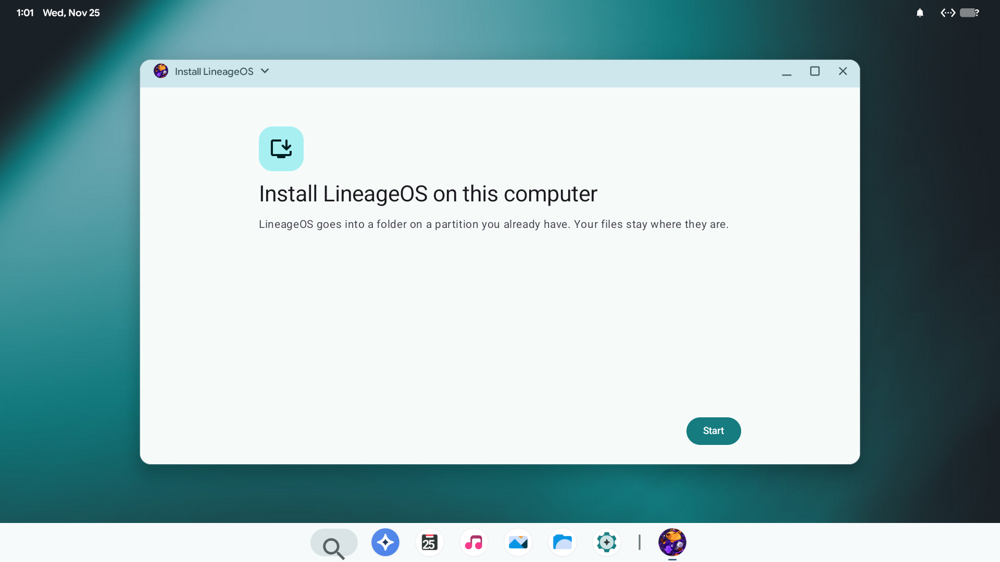

# PcInstaller

Installer for LineageOS for PCs (`lineage_pc_x86_64`, device tree `device/pc/pc_x86_64`). It runs inside the
live ISO session and installs LineageOS into a folder on a partition the computer already has; nothing is
repartitioned.

| Part | Where | What |
|---|---|---|
| `PcInstaller` | `src/`, `res/` | Compose (Material 3) app, privileged, platform certificate, `android.uid.system` |
| `PcInstallerCore` | `core/` | the app's logic in plain Kotlin: protocol client, install rules, screen state machine |
| `pc-installd` | `installd/` | root service in C: disks, mounts, copies, GRUB for UEFI and BIOS, boot entries, menus |

The service lives here, not in the device tree, because it and the app share one protocol and change together;
the device tree only adds both to `PRODUCT_PACKAGES`.

## What the app does

- **Live USB session:** install into a folder on a partition (UEFI or BIOS), update an install that is
  already in that folder (data kept), or remove it.
- **Installed system:** the app is "System updates" (launcher, and Settings > System > "System update") and
  opens on its updates screen, under a line naming the installed system by its build date and edition
  ("Installed system: Nov 27, 2026, edition with Google services."). Package format and daemon side:
  `device/pc/pc_x86_64/docs/UPDATES.md`.
  - **Check for updates:** fetches the online list,
    `https://raw.githubusercontent.com/mateusseiboth/lineage-pc-updates/main/updates.json` (format in that
    repository's README). It offers the update of the installed edition when its `build` is newer than the
    running `ro.system.build.date.utc` and it has a `url`, and the patches whose `build` is the running one and
    that are not applied yet (same name and version). "Download" saves the file in the app's files
    (`files/downloads/`, one file at most), checks its size and sha256, and goes on as a picked file. Otherwise:
    "Your system is up to date.", or a plain message when the list or the download cannot be reached.
  - **Install from a file:** "Choose the update file" opens the system file picker; pick the
    `lineage-pc-update-*.tar` downloaded from SourceForge. The app shows its version, the installed system,
    the edition (with Google services, microG, or without) and its size, or a plain message when it is for
    another edition or the file is damaged or not signed by this build's key. "Install update" shows the
    progress, then "Restart to finish the update".
  - **Patches:** the applied patches (name, description, version), each with "Remove" (after a confirmation;
    restart to finish). "Apply a patch" picks a `lineage-pc-patch-*.tar` the same way; a patch made for
    another build is refused with "This patch is for another version of the system."
  - **Update from a USB drive:** plug in a newer live USB drive, the app finds it, shows the installed and the
    new version, and updates the running install in place (data kept).

  Each package command reopens the file and sends its descriptor with the command line
  (`LocalSocket.setFileDescriptorsForSend`, cleared right after the write); `APPLY_PACKAGE` carries the app's
  language tag (`locale=pt-BR`) for the boot screen that finishes an update. The edition is read like
  pc-installd reads it (`Phonesky` or `GmsCore` under `/system`), the build from `ro.system.build.date.utc`.

  **Replaces LineageOS's Updater.** `Android.bp` declares `overrides: ["Updater"]`, so the image leaves
  `org.lineageos.updater` out. The `UpdatesEntry` alias (launcher entry of an installed system) also answers
  `android.settings.SYSTEM_UPDATE_SETTINGS`, which Settings resolves for its own "System update" entry in
  Settings > System; there is no separate injected Settings tile, so the entry appears once. `LauncherEntry`
  disables the alias in the live session, where Settings then hides that entry.

## What an install produces

```
<partition>/<folder>/            folder: default lineage (kernel argument pc.src=)
    kernel, initrd.img           from the live ISO
    system.img  or  system/      the image, or its files extracted (Linux file systems only)
    data.img    or  userdata/    sparse ext4 image of the chosen size, or a folder (Linux file systems only)
    install-<id>.id              random id, kept by updates; GRUB and pc-init (pc.id=<id>) find the folder by it
    system.old.img / system.old/ the previous system, after an update
    kernel.old, initrd.old.img   the kernel and initrd before the last update or kernel patch
    system.new.img / system.new/ an update from a package, staged; pc-init puts it in place on the next boot
    update-locale                the app's language for pc-init's update screen
    patches/NAME.img, NAME.json  a patch's overlay image and manifest (plus replaced_kernel/replaced_initrd)

UEFI
<ESP>/EFI/LineageOS/shimx64.efi  shim, signed by Microsoft (from the live ISO)
<ESP>/EFI/LineageOS/mmx64.efi    MokManager, which shim starts to enroll a key
<ESP>/EFI/LineageOS/grubx64.efi  GRUB built by build_iso.py (prefix /EFI/LineageOS), signed with the builder's key
<ESP>/EFI/LineageOS/ENROLL_THIS_KEY_IN_MOKMANAGER.der  the builder's public key, for MokManager
<ESP>/EFI/BOOT/{BOOTX64.EFI,grubx64.efi,mmx64.efi}  shim as BOOTX64.EFI with GRUB and MokManager next to it,
                                 only when BOOTX64.EFI did not exist or is ours (see below)
Boot#### + BootOrder             UEFI entry "LineageOS" starting shimx64.efi, first in the boot order (reused on
                                 reinstall; the older entry that started grubx64.efi directly is removed)

BIOS
sector 0 of the target disk      GRUB's boot.img; partition table and disk id kept, old boot code saved
core.img                         in the GPT BIOS boot partition, else the free sectors before the first
                                 partition (from LBA 34 on GPT, LBA 1 on MBR)
<partition>/pc-grub/i386-pc/     GRUB's modules; core.img finds /pc-grub/grub.cfg and loads them from here
<partition>/pc-grub/mbr-<disk>.bak  the boot code GRUB replaced

Every menu directory (EFI/LineageOS, pc-grub)
    entries/<id>.cfg             one per install: its entry plus a submenu with safe graphics (nomodeset)
                                 and the previous system (pc.previous=1, with kernel.old/initrd.old.img when kept)
    grub.cfg                     rebuilt from all entries + the other systems found + (UEFI) firmware settings
```

**The fallback path is ours** when EFI/BOOT holds our GRUB: `EFI/BOOT/grubx64.efi`, or (installs from before
shim) `BOOTX64.EFI` itself, identical to `EFI/LineageOS/grubx64.efi`. Never by shim alone: other systems put the
very same Microsoft-signed shim there. Ours is replaced on every install and removed with the last menu.

**One menu for every install.** An install adds its `entries/<id>.cfg` to every menu directory on the
computer and rebuilds each `grub.cfg`, so whichever GRUB starts lists every install; an update replaces only
its own entry; a removal deletes it, and the last removal takes GRUB with it (EFI directory, our fallback
loader, the UEFI entry, or the BIOS boot code put back from the backup).

**Other systems.** UEFI menus chainload Windows Boot Manager (`EFI/Microsoft/Boot/bootmgfw.efi`) and other
Linux loaders (`EFI/<distro>/shimx64.efi`, `grubx64.efi`, `EFI/systemd/systemd-bootx64.efi`) found on any ESP.
BIOS menus chainload the boot sector of partitions holding `bootmgr`/`ntldr` (Windows) and open other
Linux GRUB menus (`boot/grub2/grub.cfg`, `boot/grub/grub.cfg`, ...) with `configfile`. Each is found by its
file system UUID, which pc-installd reads from the superblock the way GRUB prints it.

File system rules: ext4, F2FS and Btrfs take every form; NTFS (`ntfs3`), exFAT and FAT32 take only
`system.img` + `data.img` (FAT32 also caps each file below 4 GiB). Disks formatted without a partition table
are listed like partitions. BitLocker, LUKS, LVM, RAID members, swap, ISO 9660 and unknown partitions, and
every partition of the live USB stick, are refused with a one-sentence reason.

BIOS needs room for core.img (255 sectors): disks partitioned in the last 15 years leave 1 MiB before the first
partition. Only a disk whose first partition starts at sector 63 (or a disk with 4 KiB sectors, which BIOS
cannot boot from) is refused (`no_boot_room`).

An update removes `system.old*`, renames the system to `system.old*`, writes the new one and puts the old one
back if that fails. It keeps the kernel and initrd it replaces as `kernel.old`/`initrd.old.img` (a new install
drops stale ones), and both drop the patches and any staged update. A removal deletes only the files an install
writes; other files in the folder stay.

**Update and patch packages** (format: `device/pc/pc_x86_64/docs/UPDATES.md`). pc-installd reads the package
strictly front to back from the descriptor the app passes (a pipe works): `manifest.json`, `manifest.sig`
(RSA-SHA256 checked against `EFI/LineageOS/ENROLL_THIS_KEY_IN_MOKMANAGER.der` on the ESP of the install's disk,
else the first ESP), then each listed file, whose size and sha256 are checked as it streams. Every file is
written as `*.tmp` and renamed only once the whole package checked out; images are decompressed (zstd) as they
arrive, zero blocks left as holes, and checked against `image_sha256`. An update becomes `system.new.img`, or for
an extracted install the image's files copied into `system.new/` (through a read-only loop mount); a patch
becomes `patches/NAME.img` and `NAME.json`. A new kernel or initrd moves the current one to `kernel.old`/
`initrd.old.img` (a second kernel patch keeps the first one's `kernel.old`), and the install's GRUB entry is
rewritten. The flavor comes from the running system's files: `priv-app/Phonesky` (the Play Store) is `gapps`,
`priv-app/GmsCore` without it is `microg`, otherwise `none` (microG's FakeStore also calls itself
`com.android.vending`).

The kernel command line is the live ISO's `kernel_cmdline()` (`build_iso.py`) plus `pc.id=<id>`:
`androidboot.hardware=pc androidboot.selinux=permissive firmware_class.path=/vendor/firmware console=tty0
loglevel=4 pc.src=<folder> pc.id=<id> quiet`.

## How pc-installd finds the systems

**Live session.** pc-init mounts the ISO's partition at `/mnt/src`, loop-mounts `<folder>/system.img` as
Android's root and switches root, which hides `/mnt/src`. pc-installd reads `pc.live=1` and `pc.src=` from
`/proc/cmdline`, takes the device of `/` from `/proc/self/mountinfo` (a loop device), asks the loop device for
its backing device (`LOOP_GET_STATUS64`) and mounts that partition again, read-only, at `/mnt/pc-installd/src`.
The ISO must hold `<folder>/{kernel,initrd.img,system.img,grubx64.efi,shimx64.efi,mmx64.efi,
ENROLL_THIS_KEY_IN_MOKMANAGER.der,install-live.id}` and `<folder>/grub-pc/{boot.img,core.img,i386-pc/}`.

**Installed system.** `pc.src=` and `pc.id=` come from `/proc/cmdline`; the install's partition is the device
behind `/` (through its loop device for `system.img`). A live USB drive is any other partition holding
`lineage/install-live.id`; its version is `ro.build.date.utc` / `ro.lineage.display.version` from the
`system/build.prop` inside its `system.img`, compared with `/system/build.prop`. The running install can be
updated (the loop device keeps the old image open until the reboot) but not removed.

Android does not mount efivarfs; pc-installd mounts it on `/sys/firmware/efi/efivars` before reading
`SecureBoot` or writing boot entries. A partition that cannot be mounted read-only to measure its free space
(Windows hibernated or with Fast Startup) is listed with `reason=mount_failed`.

## Secure Boot

The computer starts shim (signed by Microsoft, trusted by every Secure Boot firmware), shim starts our GRUB and
GRUB the kernel, both signed with the key of whoever built the ISO. shim trusts that key once it is enrolled as a
Machine Owner Key (MOK). The installer never assumes a key: it copies `ENROLL_THIS_KEY_IN_MOKMANAGER.der` from the
live source and compares that file with what shim trusts.

- **Already enrolled** (the live USB drive started with Secure Boot on, so the key was enrolled on this computer):
  nothing to do. pc-installd reads `MokListRT`, `MokListRT1`... (shim's runtime copy of its key list) and the
  firmware's `db`.
- **Not enrolled:** the app offers to prepare the key. `ENROLL_KEY` does what `mokutil --import` does: it writes
  `MokNew` (an X.509 `EFI_SIGNATURE_LIST` owned by shim, appended to a pending request) and `MokAuth` (SHA-256 of
  `MokNew` followed by the password in UTF-16LE) under shim's GUID `605dab50-e046-4300-abb6-3dd810dd8b23`. At the
  next start MokManager asks to enroll it: press a key, Enroll MOK, Continue, Yes, the password, Reboot. The
  password is eight random digits, because MokManager reads a US keyboard.
- **Without the app:** with Secure Boot on and the key missing, shim cannot verify GRUB and opens MokManager;
  choose "Enroll key from disk" and pick `ENROLL_THIS_KEY_IN_MOKMANAGER.der` (on the ESP in `EFI/LineageOS`, or on
  the live USB drive).

With Secure Boot off, shim starts GRUB without checking, so the same files work either way.

## Protocol (version 3)

Unix stream socket `/dev/socket/pc_installd` (0660 root:system); only uid 0 and 1000 are served, one client at
a time. The app starts the service with `ctl.start pc_installd`.

Every line is `WORD key=value key=value...\n`. Values are percent-encoded UTF-8: every byte outside
`[A-Za-z0-9._/:+,-]` is written as `%XX`, so values hold no spaces, `=` or newlines. A request gets zero or more
data lines, then `OK` or `ERR code=<error>`.

| Request | Data lines | Meaning |
|---|---|---|
| `INFO` | `INFO version=3 uefi= secure_boot= mok_enrolled= mok_queued= live= source= folder= kernel= initrd= system= installed= install_part= install_folder= install_system=image/folder install_version= install_build_utc=` | the live source (sizes in bytes) or the running install; `mok_enrolled`: shim trusts the source's key, `mok_queued`: MokManager will ask for it (both 0 without a source or UEFI) |
| `LIST` | `PART name= disk= fs= label= size= free= esp= source= usable= reason= folders= max_file=` | one per partition or whole-disk file system; `reason` is an error code when `usable=0` |
| `INSPECT part= folder=` | `STATE system= data= old=<bytes>` | what the folder already holds |
| `CHECK part= folder= system=image/folder data=image/folder/keep data_size=` | `PLAN mode=install/update need= free= boot=uefi/bios esp=` | validates without writing |
| `INSTALL` (same fields as `CHECK`) | `PROGRESS step=prepare/kernel/system/data/boot/finish percent=0..100` | validates again, then installs or updates |
| `UNINSTALL part= folder=` | `PROGRESS step=prepare/remove/boot/finish percent=` | removes the install and its menu entries |
| `FIND_UPDATE` | `UPDATE source= version= build_utc= current_version= current_utc= newer=0/1 mok_enrolled= mok_queued=` | installed system: finds a live USB drive and makes it the source of the next `INSTALL` |
| `ENROLL_KEY` | `MOK password=<8 digits>` | queues the source's key for MokManager (`source_missing` without it, `efi_failed` when the variables cannot be written) |
| `PACKAGE_INFO` (+fd) | none: `OK type= version= name= description= flavor= build= current_build= current_flavor= kernel= initrd= system= overlay= size=` | installed system: reads an update or patch file; the app also refuses an update of another flavor and a patch whose `build` is not `current_build` |
| `APPLY_PACKAGE locale=` (+fd) | `PROGRESS step= percent=`, then `OK reboot=1` | stages the update (next boot) or applies the patch |
| `PATCHES` | `PATCH name= version= description= kernel= initrd=` | the applied patches, in name order |
| `REMOVE_PATCH name=` | none: `OK reboot=1` | deletes the patch (it stops at the next boot) and puts back `kernel.old`/`initrd.old.img` when it replaced them and no other patch did; `bad_request` for an unknown name |

`(+fd)`: the package's file descriptor travels with the line (`SCM_RIGHTS`); pc-installd closes it after the
command. The four package commands are specified in `device/pc/pc_x86_64/docs/UPDATES.md`; pc-installd answers
errors with `ERR code=` like every other command (the app also accepts `ERROR code=`). `PACKAGE_INFO` reads the
whole package to check every hash and writes nothing; its `size` is what the package writes (images
decompressed, kernel, initrd). `APPLY_PACKAGE` checks the room first (`no_room`) and reports the steps
`prepare`, `kernel`, `system`, `boot`, `finish`.

### Errors

`bad_request`, `bad_folder`, `unknown_partition`, `source_missing`, `source_partition`, `no_esp`,
`no_boot_room`, `fs_unsupported`, `bitlocker`, `encrypted`, `lvm`, `raid`, `fs_images_only`, `file_too_large`,
`no_space`, `data_too_small`, `data_exists`, `no_data_to_keep`, `mount_failed`, `copy_failed`, `data_failed`,
`esp_failed`, `efi_failed`, `boot_failed`, `menu_failed`, `io_error`, `not_installed`, `running_system`,
`no_update_source`, and for the package commands `bad_package`, `bad_signature`, `no_certificate`,
`wrong_flavor`, `wrong_base`, `no_room`, `io`. The app adds `daemon_unreachable`, `file_unreadable` (the
picked file cannot be opened), `network` and `catalog_unreadable` (the online list), `download_failed` and
`download_damaged` (size or sha256 not the list's). Each has a one or two sentence text in
`res/values*/strings.xml`.

## Tests

```sh
make -C installd test          # 138 C tests (fake sysfs/dev/efivars machine) + socket and cmdline tests (Python)
core/run_tests.sh              # 44 JUnit tests of the app core, with external/kotlinc and JUnit from prebuilts
python3 -m unittest discover -s tests   # UI strings: both languages, placeholders, no em dash
tools/typecheck.sh             # compiles core + Compose UI against the prebuilts (needs a previous build's out/)
tools/bios_boot_test.sh        # boots GRUB for BIOS written by biosboot.c in QEMU/SeaBIOS (three disk layouts)
```

The C tests use `mke2fs`, `mkfs.vfat`, `sgdisk`, `sfdisk` and `grub2-script-check` (every generated menu goes
through GRUB's own parser) from the host when present and skip otherwise. The BIOS boot code was also booted
in QEMU/SeaBIOS from an MBR gap, a GPT gap and a GPT BIOS boot partition: GRUB found `/pc-grub/grub.cfg` each
time. In Soong: `PcInstallerCoreTests` (`java_test_host`, `atest`-able).

## Build integration

- local manifest: `<project path="packages/apps/PcInstaller" name="android_packages_apps_PcInstaller" remote="pc" revision="lineage-24.0" />`
- `device.mk`: `PRODUCT_PACKAGES += PcInstaller pc-installd`
- `BoardConfig.mk`: `SYSTEM_EXT_PRIVATE_SEPOLICY_DIRS += packages/apps/PcInstaller/installd/sepolicy/private`
- `pc-installd` links BoringSSL's `libcrypto` (OpenSSL's `-lcrypto` on the host) and loads the platform's
  `libzstd.so` with `dlopen`: external/zstd's `Android.bp` does not make the library visible to this package
- the device tree's `iso/build_iso.py` puts `grubx64.efi`, `shimx64.efi`, `mmx64.efi`,
  `ENROLL_THIS_KEY_IN_MOKMANAGER.der`, `grub-pc/` and `install-live.id` on the ISO

## Limits

- **SELinux.** `pc_installd` is a permissive domain without allow rules: AOSP's neverallows forbid a
  coredomain from mounting file systems, writing raw block devices and relabeling every file type, all of
  which the installer must do. An enforcing build needs a vendor-side helper domain.
- **LVM and RAID.** Android has no LVM or md tools to assemble the volumes, so their members are listed with
  the reason instead of being offered.

## Screenshots

Taken in QEMU/KVM at 1920x1080 from the live ISO.



Installer, first page.

## Credits

- [LineageOS](https://lineageos.org) ([GitHub](https://github.com/LineageOS)): the base system and build this is part of.
- [Android Open Source Project](https://source.android.com): the platform, its APIs and build system.
- [BlissOS](https://blissos.org) ([GitHub](https://github.com/BlissOS)) and the [Android-Generic Project](https://github.com/android-generic): the approach to running Android on PCs that this project follows. Its installer, [aaropa](https://github.com/BlissOS/bootable_aaropa), inspired the install layout (no code is shared).
- [Android-x86](https://www.android-x86.org): the original Android-on-PC work, including installing into a folder and booting through GRUB. Its `newinstaller` defined the folder install this follows.
- [GRUB](https://www.gnu.org/software/grub/): the boot loader the installer sets up.
- [shim](https://github.com/rhboot/shim) and its MokManager (Fedora's Microsoft-signed build): Secure Boot with the builder's own key.
- [mokutil](https://github.com/lcp/mokutil): the reference for the `MokNew`/`MokAuth` format `ENROLL_KEY` writes.
- Icon: capybara artwork by Mateus Seiboth (art/installer-capybara.png).

Thanks to everyone behind these projects. Files taken from them keep their original licenses and copyright notices.
